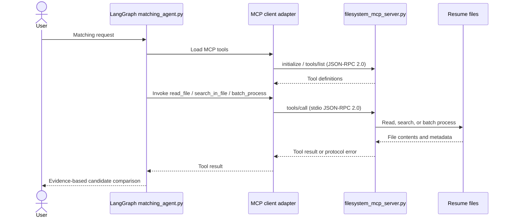

# Resume MCP Assistant

A standalone Python project demonstrating filesystem tools, the Model Context Protocol (MCP), and a LangGraph resume-matching agent. It includes its own filesystem utilities, tests, and fictional sample resumes.

## Requirements

- Python 3.10 or newer
- An OpenAI API key for natural-language assistant requests
- Dependencies in `requirements.txt` for the MCP server and LangGraph agent

## Setup

From this directory, create and activate a virtual environment, then install dependencies:

```bash
python -m venv .venv
source .venv/bin/activate
pip install -r requirements.txt
```

Set your API key in the shell (do not commit it):

```bash
export OPENAI_API_KEY="your-api-key"
```

The default model is `gpt-4o-mini`. Override it with `OPENAI_MODEL` if needed.
Set `RESUME_DIRECTORY` to change the server's default resume directory. Resource URIs only serve files beneath this configured directory.

## Use the Filesystem Tools

```python
from fs_tools import list_files, read_file, search_in_file, write_file

print(list_files("resumes", ".txt"))
print(read_file("resumes/resume_alex_morgan.txt"))
print(search_in_file("resumes/resume_alex_morgan.txt", "python"))
print(write_file("output/summary.txt", "Backend engineer with Python experience."))
```

`read_file` extracts UTF-8 text files, PDFs, and DOCX documents. PDF and DOCX support uses `pypdf` and `python-docx`; scanned PDFs may require OCR, which is not included. File read errors return `success: false` and an `error` message. `list_files` returns an empty list when the directory cannot be listed.

## MCP Filesystem Server

Run the MCP server over stdio (the normal transport for a local MCP client):

```bash
python filesystem_mcp_server.py
```

The FastMCP SDK implements JSON-RPC 2.0 framing and protocol lifecycle over stdio. Clients can discover tools with `tools/list`, resources with `resources/list`, and the resume resource template with `resources/templates/list`. The server provides:

- Tools: `read_file`, `list_files`, `write_file`, `search_in_file`, `watch_directory`, `batch_process`, and `get_server_config`.
- Resources: `resumes://directory` and `resume:///{filename}`.
- Configuration: `RESUME_DIRECTORY` selects the default directory; supported extensions and processing limits are available from `get_server_config`.
- Bounded watch operations (maximum five minutes) and concurrent batch reads (up to eight workers).

Filesystem operations preserve the original `fs_tools.py` behavior. `list_files` defaults to the configured resume directory; tools that accept explicit paths continue to accept those paths. The resource interface is read-only and restricts file resources to the configured directory.

## LangGraph MCP Agent

The refactored matching agent obtains its tools from the filesystem MCP server; it does not import or call `fs_tools.py` directly:

```bash
python matching_agent.py --list-resources
python matching_agent.py "Which candidates have Python and AWS experience?"
python matching_agent.py --resume-directory /path/to/resumes "Compare candidates with PostgreSQL experience"
```

The agent needs `OPENAI_API_KEY` for model requests. `--list-resources` discovers the server's resource catalog without making an LLM request. Resume text is sent to the configured model provider when the agent reads it; review model output before relying on it.

### Agent ↔ MCP workflow



### Test scenarios

`tests/test_filesystem_mcp_server.py` launches the actual stdio server and checks:

1. MCP initialization, tool/resource discovery, and the resume resource template.
2. Batch reading and case-insensitive keyword searches through `tools/call`.
3. Directory watching, including filtering for new resume files.

`tests/test_matching_agent.py` checks that the MCP adapter loads server tools and that LangGraph can build the matching agent without making an external model request.

Run all tests with:

```bash
python -m unittest discover -s tests -v
```

For a timed walkthrough and recording cues, see [DEMO_SCRIPT.md](DEMO_SCRIPT.md). The script is a recording guide; an actual video must be recorded separately.
